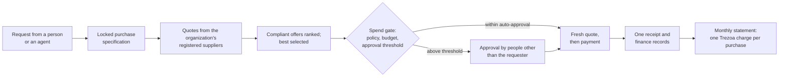

# Trezoa

**Trezoa lets businesses hand routine purchasing to AI agents while keeping control: spending limits enforced by code, a verifiable record of each purchase, and evidence that the price was competitive.**

The organization decides what each agent may spend, on what and with whom. Trezoa enforces those limits, records evidence for every payment, and is designed to bill for its service with one charge per purchase, which can be tied to savings proven against competing quotes.

> **Status, October 2026: pre-launch.** Trezoa's software is implemented and has been tested on a single host, with mocks and simulators standing in for external payment, tax and banking providers. According to the engineering repository's own records, no Trezoa network has been launched, no release has been made, no external security audit has been performed, and the platform's pricing has not been activated. [Section 10](#10-progress-and-evidence) sets out what has and has not been validated.

## Contents

- [Executive summary](#executive-summary)
- [1. Company and purpose](#1-company-and-purpose)
- [2. The customer problem](#2-the-customer-problem)
- [3. The product](#3-the-product)
- [4. Customer value](#4-customer-value)
- [5. Business model](#5-business-model)
- [6. Differentiation](#6-differentiation)
- [7. Technology foundations](#7-technology-foundations)
- [8. TRZ and network economics](#8-trz-and-network-economics)
- [9. Other products](#9-other-products)
- [10. Progress and evidence](#10-progress-and-evidence)
- [11. Next milestones](#11-next-milestones)
- [12. Company, team and contact](#12-company-team-and-contact)
- [13. Lineage, licensing and credits](#13-lineage-licensing-and-credits)
- [14. Sources](#14-sources)

## Executive summary

**What Trezoa is.** A purchasing platform for AI agents, together with Trezoa's own blockchain network (a "Layer 1"), on which agents' spending limits are enforced by code. It is designed to let an organization's agents buy API and data services, compute, and goods and services from suppliers the organization registers, inside limits the organization sets.

**The problem.** Businesses want agents to handle routine, often recurring purchases, but a finance team can only allow that if three things are true: the agent cannot exceed its authority, every payment leaves a record that cannot be quietly altered, and the price can be shown to be competitive. Without purpose-built tooling, those controls are largely manual: shared cards and API keys, approvals by email, receipts gathered after the fact.

**What a customer does.** An administrator sets budgets and approval rules for each agent and team. An agent, or a person, turns a request into a precise purchase specification. Trezoa collects quotes from the organization's own suppliers, selects the best compliant offer, checks the spend against every limit, routes larger purchases to human approvers, pays, and records one receipt. Finance sees every purchase, every exception and one monthly statement.

**How Trezoa earns revenue.** The buyer organization pays Trezoa a charge for each purchase, invoiced monthly in US dollars, whatever asset pays the supplier. For competitive purchases (compute and general procurement) under a Shared Savings agreement, the charge is the highest of three candidates, never their sum: a volume-based Service Fee, a share of the savings proven against the next-best qualifying quote, or recovery of the paid AI used. Other platform payments carry the Service Fee alone, and institutional tokenization has its own fee line. Supplier payments, network fees and the TRZ token are separate from this revenue. Pricing is implemented but not activated, and some settlement paths do not yet carry every candidate: [section 5.5](#55-how-the-rules-apply-to-each-settlement-path) explains which, and what monetizing them requires.

**Where things stand.** The core product exists in code and runs end to end in controlled tests: the on-chain spending controls, the purchasing workflow, the console, the API and SDK, and the billing engine. The work ahead turns that software into an operating business: an independent security audit, key ceremonies, a multi-host network, live provider and supplier integrations, licensing, and first design-partner customers.

## 1. Company and purpose

Trezoa's engineering goal is to let AI agents and machines hold, spend and prove value inside limits that a person or institution sets, with those limits enforced by code rather than by trusting the agent. As agents start to call paid APIs, rent compute and order goods, a business needs to prove that an agent paid only for what it was allowed to buy, at a defensible price.

Trezoa is designed as one product built from three parts, each holding a different kind of authority:

- **The purchasing platform** is the customer interface and the automation runtime: an organization console, a versioned API and a TypeScript SDK through which people and agents request, approve, execute and reconcile purchases. It is where Trezoa's commercial relationship with the customer lives, and where its charge is calculated and invoiced.
- **The Agent Account program** holds financial authority. It is an on-chain program that holds an organization's funds and gives each agent bounded authority over them; for payments on the Trezoa network, the network enforces the limits.
- **The Trezoa Layer 1** is the settlement and enforcement layer: a Rust blockchain derived from the Solana validator, which settles Agent Account payments and anchors their receipts. Its network fees go to the protocol, not to Trezoa's platform revenue.

The same billing engine also serves a second product line, institutional tokenization ([section 9](#9-other-products)). A cryptocurrency exchange is being developed separately from the purchasing platform and is not described in this document.

Trezoa Global, Inc. (Delaware) is the intended parent company; [section 12](#12-company-team-and-contact) describes the related entities and what has not yet been done.

## 2. The customer problem

Consider a company whose engineering teams buy GPU time from several compute providers, whose data team subscribes to paid APIs, and whose operations team reorders the same equipment every quarter. Much of this spend recurs, the decisions are rule-based, and the buying is repetitive. It is the kind of work a business would like an agent to do.

The existing workflow makes that hard:

- **Authority is coarse.** An agent that can pay usually holds a card, an API key or a wallet with a single limit. Nothing stops it spending its whole allowance with one supplier, on the wrong item, or in one afternoon.
- **Approvals happen outside the payment.** Requests for larger purchases travel by email or chat. Whether the payment that followed matches what was approved is checked later, if at all.
- **Evidence is scattered.** The quote sits in one system, the payment in another and the receipt in a third. Finance reconstructs the story at month end.
- **Price is asserted, not shown.** "We got a good price" is rarely backed by the competing quotes that were actually received for the same item at the same time.

The result is an unattractive choice: keep agents away from money and keep paying people to do repetitive buying, or let agents spend under controls that are hard to audit. Trezoa is designed for businesses that want neither.

## 3. The product

### 3.1 Components

| Component | What it does |
|---|---|
| **Console** | A web application for administrators, approvers and finance: organization and agents, purchase specifications, suppliers and procurement, services and compute, finance and assets, service fees, integrations and operations. It holds no authority of its own; it uses the same API as everyone else. |
| **Platform API and SDK** | A versioned REST API with OAuth client credentials, and a TypeScript SDK (`@trezoa/agent-sdk`). Customer systems and agents use these to create and run purchases, receive signed webhooks and export records. |
| **Purchase specification engine** | Turns a free-form request into a precise, versioned specification. Hard requirements decide which offers are eligible; preferences only rank them. AI may help structure the request but never decides compliance. |
| **Procurement engine** | Buys goods and services from the suppliers an organization has registered and verified: collects quotes, evaluates them against the locked specification, obtains a fresh quote before paying, pays, and records one receipt. Suppliers connect through Trezoa's supplier API or through x402. |
| **Compute market** | Lets an agent request provider-signed quotes for a compute job and buy the best acceptable one under the buyer's own weighting (for example, the cheapest), with escrow and metered release. Providers run Trezoa's compute-provider software. |
| **Agent Account program** | Holds funds on the Trezoa L1 and enforces each agent's limits on chain: caps per payment, per period and over the lifetime of the authorization, an allow-list of recipients, freeze and revocation, and delegation to sub-agents. |
| **Agent protocols** | Hosted agent wallets reachable over MCP and A2A, and payments for HTTP resources over x402. |

### 3.2 A purchase, step by step



1. **Set up.** An administrator creates the organization's units and members, registers its agents, and sets a policy for each agent or team: an auto-approval threshold, a hard maximum per payment, a budget per period, allowed recipients, and how many approvers a larger purchase needs (one to three). For the whole organization, the administrator also decides which suppliers may be used. The agent's on-chain authority is granted from the organization's Agent Account.
2. **Specify.** A request such as "500 laptops of this configuration, delivered by a given date" becomes a purchase specification. Ambiguities are resolved through clarification; once confirmed, the specification is locked and its digest becomes part of every later record.
3. **Source.** The procurement engine asks the organization's active suppliers for offers and live quotes, within fixed limits on time and number of calls. Supplier text is treated as untrusted until it is normalized into typed facts, and each offer is checked against the specification.
4. **Select.** Compliant offers are ranked deterministically. The same inputs produce the same choice, and the reasons for every rejection are recorded.
5. **Authorize.** The spend gate checks the organization's policy, the agent's budget and any kill switches. Purchases above the auto-approval threshold wait for the required number of approvers, none of whom may be the requester. An approval does not override an on-chain limit.
6. **Pay.** Trezoa takes a fresh, authoritative quote, records the payment instruction before any money moves, and pays on the authorized rail. After a crash, recovery resumes the same payment key rather than starting a new payment, and an uncertain outcome is resolved by querying the authoritative record rather than by retrying.
7. **Record.** The purchase ends with one receipt that binds the specification, the supplier, the offer terms, the payment and its reference on the payment rail, tax and landed cost. Approval votes are recorded in the audit log under the same purchase. On the Trezoa L1, each payment also extends a hash chain of receipts for that agent's authorization.
8. **Reconcile and bill.** Finance reviews activity, exceptions and reconciliation in the console or by export. Trezoa's own charge for the purchase appears on a separate monthly statement ([section 5](#5-business-model)).

### 3.3 Where each control is enforced

| Control | Enforced by | Applies to |
|---|---|---|
| Caps per payment, per window and per lifetime; recipient allow-list (1 to 8 addresses); freeze and revocation | The Agent Account program, on chain | Payments on the Trezoa L1 |
| Delegation to sub-agents, up to four levels, where each child's limits must fit inside its parent's | The Agent Account program, on chain | Payments on the Trezoa L1 |
| Organization and team policies, budgets per asset, approval thresholds, separation of duties | The platform's spend gate | Every purchase the platform executes |
| Supplier allow-lists, specification compliance, quote verification, deterministic selection | The procurement and compute engines | Procurement and compute purchases |
| Signing keys | A separate signer service that holds keys in a hardware security module over PKCS#11 | Every platform-held key |

On-chain enforcement covers payments made on the Trezoa L1. Payments on other rails, such as US bank transfers or other blockchains, are bounded by the platform's policy and the rail's own controls rather than by the Agent Account program.

### 3.4 Settlement options

Each purchase settles in one asset on one authorized route; for goods and services, the route is chosen among the destinations the supplier has verified. Nothing is converted silently along the way.

| Settlement rail | Used for |
|---|---|
| TRZ on the Trezoa L1, through Agent Accounts | Compute, hosted wallet and x402 payments; goods and services from suppliers that price in TRZ |
| Approved tokens on the Trezoa L1 | Compute purchases, once a token is approved and enabled |
| US dollars over ACH (Stripe Connect), with tax from Avalara | Goods and services |
| USDC, USDT and ETH on EVM networks, directly; USDC and ETH also over x402 | Goods and services |
| EUR bank payments, FX conversion, JPY, KRW and CNY | Goods and services, in development and test only |

The validation status of each rail is in [section 10](#10-progress-and-evidence).

### 3.5 Integrations

- **REST API and webhooks.** Versioned `/v1` API, OAuth client credentials with live revocation on every request, signed webhooks and deterministic CSV and JSONL exports.
- **TypeScript SDK.** `@trezoa/agent-sdk` 0.1.0 covers the platform API.
- **MCP and A2A.** Hosted agent wallets expose paid tools and skills to agents over the Model Context Protocol and the Agent2Agent protocol.
- **x402.** Pay-per-request HTTP payments, as a buyer and as a facilitator.
- **Suppliers and providers.** Suppliers connect through Trezoa's own supplier API or offer x402 resources, and compute providers run Trezoa's compute-provider software. Bringing suppliers onto these interfaces is part of the go-to-market work ([section 11](#11-next-milestones)).

## 4. Customer value

The benefits below follow from how the product is built. They have not yet been measured with customers.

- **Control that holds under automation.** Limits are enforced where money moves, not in the agent's prompt. Delegation can only narrow authority, an organization can narrow a wallet's limits but not widen them, and revoking an agent is enforced across the platform's surfaces and, for on-chain authority, by the program itself.
- **Evidence a finance team can rely on.** Each completed purchase produces one receipt linking the specification, the offer and the payment, and approval votes are recorded in the audit log under the same purchase. Trezoa L1 payments are anchored in a per-authorization hash chain, and gaps in evidence are recorded as gaps rather than filled in.
- **Price discipline.** Agents buy against competing quotes for an identical scope, and the selection is reproducible. When a purchase beats the next-best qualifying quote, the saving is measured and recorded.
- **Less manual finance work.** Activity, approvals, exceptions, refunds and reconciliation sit in one ledger with exports, so month-end work starts from records rather than reconstruction.
- **Pricing aligned with results.** Where competing quotes exist and savings are material, Trezoa's charge is a share of the savings it proved; where savings are small or absent, the volume-based Service Fee or AI cost recovery applies instead ([section 5](#5-business-model)).

Trezoa does not guarantee savings. A spending budget is never treated as a baseline: a $1,000 budget spent on a $70 purchase is not $930 of savings.

## 5. Business model

### 5.1 Who pays, and in what currency

The **buyer organization** pays Trezoa for the use of its platform. Two currencies are involved, and they are independent:

- **The supplier is paid in the settlement asset of the purchase**: US dollars over ACH, a token on an EVM network, or TRZ or an approved token on the Trezoa L1 ([section 3.4](#34-settlement-options)).
- **Trezoa's charge is invoiced to the organization monthly, in US dollars, off chain**, and collected by ACH debit. It is never taken from the supplier's payment and never collected in TRZ. (The code also supports a separate euro billing account for purchases priced in euros, a path that is in development and test only.) The proposed invoicing entity in the billing configuration is Trezoa Inc.

Trezoa's revenue is kept apart from everything else that moves through a purchase:

| Flow | Who receives it | Trezoa revenue? |
|---|---|---|
| The purchase price (principal) | The supplier, in full | No |
| Taxes | The supplier or the tax authority | No |
| Refunds owed to the buyer | The buyer | No |
| Trezoa L1 network fees | The network, under its protocol rules | No; no Trezoa billing record can hold a network fee |
| TRZ genesis allocations, including the Trezoa Inc. treasury class | Their genesis beneficiaries, under lock and release schedules ([section 8](#8-trz-and-network-economics)) | Not platform revenue |
| **The Trezoa charge for the purchase** | **Trezoa, by monthly invoice** | **Yes** |

### 5.2 The revenue model

The platform's pricing has three components, each with a proposed initial schedule that is implemented in the billing engine, not yet activated, and subject to each customer's agreement:

| Component | Basis | Proposed initial schedule |
|---|---|---|
| **Service Fee** | The purchase's settled volume: the principal plus authoritative supplier charges, never tax | Marginal tiers on the organization's monthly volume: 0.050% up to $10M, 0.025% to $100M, 0.010% to $1B, 0.005% to $10B, 0.0025% above. Payments settled in TRZ are exempt. |
| **Shared Savings** | The purchase's verified gross savings | Marginal bands on the organization's verified savings in each calendar month: 20% of the first $250,000, then 5% of everything above, with no cap. |
| **AI execution cost** | The paid AI used for the purchase | Recovery of evidenced AI usage at a registered price schedule, within a ceiling the customer authorizes in advance. Cost recovery only; $0 when no paid AI was used. |

How the components combine depends on the kind of purchase:

- **Competitive purchases under a Shared Savings agreement.** For compute purchases and general procurement, where competing quotes exist, Trezoa computes all three as candidates and bills only the highest:

  ```text
  Trezoa charge = max( Service Fee candidate,
                       Shared Savings candidate,
                       AI execution cost candidate )
  ```

  The candidates are never added together. All three are shown to the customer, with the one applied named; the other two are disclosed but not billed. Each purchase counts toward the organization's monthly volume and monthly savings totals, which set the tier and band for the next purchase, whichever candidate wins.
- **Direct payments, and organizations without a Shared Savings agreement.** Hosted wallet payments, x402 resources and paid MCP tools and A2A skills have one seller and one price, so there are no savings to measure. These payments, and every purchase of an organization without a Shared Savings agreement, carry the Service Fee alone.
- **Institutional tokenization** has its own Service Fee line and is outside the single-charge rule ([section 9](#9-other-products)).

**What counts as savings.** The baseline is the lowest price among the *other* qualifying quotes the same purchase received from other suppliers or providers: live quotes for exactly the same scope, valid at the moment of selection. For goods and services, that means the same lines and quantities under the same locked specification, compared on the price payable before tax, in the same currency. For compute, it means provider-signed quotes for the identical job. A budget, a list price, a market average, a prior price or a number the customer typed in is never a baseline. If no qualifying competing quote exists, savings are "not assessable" and the Shared Savings candidate is zero.

### 5.3 Illustrative examples

The examples apply the proposed formula to hypothetical competitive purchases settled in US dollars. They are not results or projections. Each assumes the organization is still inside the first Service Fee tier and the first $250,000 Shared Savings band for the month.

| Example | Next-best qualifying quote | Price paid | Verified savings | Service Fee | Shared Savings | AI cost | Trezoa charge (applied) | Customer's net benefit |
|---|---:|---:|---:|---:|---:|---:|---|---:|
| A. $30 saving | $100 | $70 | $30 | $0.035 | $6.00 | $0.01 | **$6.00** (Shared Savings) | $24.00 |
| B. $2 saving | $100 | $98 | $2 | $0.049 | $0.40 | $0.01 | **$0.40** (Shared Savings) | $1.60 |
| C. No saving, paid AI used | $100 | $100 | $0 | $0.05 | $0 | $0.14 | **$0.14** (AI cost) | −$0.14 |
| D. Equipment order | $500,000 | $425,000 | $75,000 | $212.50 | $15,000 | $0 | **$15,000** (Shared Savings) | $60,000 |

In every case the supplier receives the full price paid. Example C shows the customer's position as negative, because a purchase without savings is never presented as one.

The Shared Savings bands are marginal and uncapped. If one organization's verified savings reach $20,000,000 in a month, the Shared Savings candidates for that month total $50,000 from the first band plus $987,500 from the rest, or $1,037,500, leaving the organization $18,962,500 of its savings. That total is the month's charge only if Shared Savings is the highest of the three candidates on every one of those purchases; the size of the savings alone does not establish that.

### 5.4 How revenue relates to activity

The model ties revenue to two things: the volume of purchases an organization runs through Trezoa, through the Service Fee, and the savings Trezoa proves on competitive purchases, through Shared Savings. The Service Fee rate falls as an organization's monthly volume rises, and the Shared Savings share falls above $250,000 of monthly savings, so large customers pay a lower effective rate as they grow.

Recurring purchases are where the model is designed to compound: subscriptions, compute and repeat orders are bought again every period, and each purchase that carries a charge produces one again in the next period. Whether a given recurring purchase carries a charge today depends on how it settles, as the next section explains.

### 5.5 How the rules apply to each settlement path

Payments settled in TRZ are exempt from the Service Fee, because TRZ has no fixed US dollar value and the production fee schedule does not price it. That exemption covers the Service Fee only. Shared Savings and AI cost recovery follow their own valuation and agreement rules, which produce the following behavior as built:

| Purchase type and settlement | Service Fee | Shared Savings | AI execution cost |
|---|---|---|---|
| Goods and services settled in US dollars over ACH | Applies | Applies | Applies |
| Goods and services settled in USDC, USDT or ETH on an EVM network | Applies, at the purchase's pinned valuation of the token | Applies, at the same pinned valuation | Applies |
| Goods and services settled in TRZ on the Trezoa L1 | Exempt | Applies, measured at the purchase's own pinned TRZ valuation | Applies |
| Compute settled in an approved US-dollar-designated token on the Trezoa L1 | Applies | Applies | Applies |
| Compute settled in TRZ | Exempt | Not assessable: production agreements value only US-dollar-designated tokens, never TRZ | Applies |
| Hosted wallet, x402, MCP and A2A payments (settled in TRZ) | Exempt | Not applicable | Not applicable |

The competitive-purchase rows follow the single-charge rule: the highest applicable candidate is billed, and an exempt or not-assessable candidate counts as zero.

Monetizing the paths that currently carry little or no charge needs specific steps rather than a change of model:

- **Competitive compute purchases** can carry the single-charge rule in full, under a Shared Savings agreement, once a US-dollar-designated token is approved and enabled for compute settlement on the Trezoa L1. Approved-token settlement is implemented but is refused in production until verified token-program artifacts exist and the owners approve the asset.
- **Direct hosted-wallet payments** (including x402 resources, paid MCP tools and A2A skills) remain Service-Fee-only. As built they settle in TRZ, so they carry no charge today. A different settlement asset would not make them eligible for Shared Savings or AI cost recovery: they have one seller, one price and no competing quotes.
- **TRZ itself stays exempt.** In the documented source revision, the production checks require every Service Fee pricing version to list TRZ as exempt, and reject any Shared Savings agreement that assigns TRZ a valuation. An operator cannot change this by registering a pricing version or an agreement; pricing TRZ would need separately authorized policy and implementation changes.
- **Goods and services settled in TRZ**, which are measured at each purchase's own pinned TRZ valuation rather than through the agreement, need at least three contracted, production-grade TRZ price sources before the TRZ procurement rail can be activated, along with registration of Trezoa's network identifier and the production program identifiers.
- **US dollar and EVM settlement** need the live provider validation described in [section 10](#10-progress-and-evidence).

### 5.6 Status of pricing

The Service Fee, Shared Savings and AI cost engines are implemented and tested, with replayable proofs for every applied charge. None is activated: no pricing version is registered in any environment, and no Shared Savings agreement is registered for any organization. Before activation, each customer needs an executed agreement and disclosure, and the owners must settle the invoicing entity, tax treatment and revenue-recognition policy.

## 6. Differentiation

Trezoa's differentiation is in specific design decisions, each implemented and covered by tests:

- **Authority that only shrinks.** A sub-agent's limits must fit inside its parent's in every dimension, and its lifetime cap is reserved from the parent's, so delegation is designed not to raise total spending.
- **Approvals that do not override limits.** The requester cannot approve their own request, the approver quorum is fixed when the request is created, and an approval does not bypass an on-chain limit.
- **One logical purchase, one charge.** Each purchase receives one commercial decision, keyed to its purchase identifier across the Service Fee, Shared Savings and AI cost records.
- **A savings baseline built only from competing quotes.** Only qualifying quotes for the identical scope count, never budgets or estimates, and each applied charge carries the evidence needed to replay its calculation.
- **Idempotent money movement.** On the Trezoa L1, each payment key can settle at most once. On every rail, the payment instruction is written before money moves, and recovery after a crash resumes the same payment key rather than starting a new one.
- **Exact amounts.** Assets are identified exactly, never by ticker; budgets are per asset; amounts are integers in each asset's base units; and any valuation or conversion uses an explicit, recorded rate.
- **Fail closed in production mode.** Simulators, test keys, missing providers and development databases are refused at startup.

How this compares with the controls many businesses rely on today when software spends money:

| Question a finance team asks | Shared cards, API keys and approvals by email | A payment protocol used on its own | Trezoa |
|---|---|---|---|
| Can each agent have its own limits by period and recipient? | Partly: card programs offer per-card limits and merchant categories; API keys usually carry one cap | Depends on the wallet | Yes: limits per agent, team and asset; supplier allow-lists per organization |
| Can a larger purchase require approval by someone else? | Often a separate workflow from the payment | Not part of the protocol | Yes, one to three approvers, never the requester |
| Is there one record linking request, quote and payment? | Partly, assembled from separate systems | The payment only | Yes: one receipt per purchase, with approvals recorded under the same purchase |
| Is the price backed by competing quotes for the same scope? | Rarely recorded | No | Yes, where competing quotes exist |

Spend-management and procurement software already offers approval workflows and competitive bidding for people. Trezoa's design target is purchases initiated and paid by software agents, with the controls bound to the payment itself.

## 7. Technology foundations

### 7.1 Separation of authority

The architecture keeps four kinds of authority apart. Financial authority stays on chain, in Agent Account policies, delegation and escrow. Signing stays behind a dedicated signer service that holds keys in a hardware security module. Orchestration stays in the commerce engines. The platform is the customer interface and the automation runtime, and it re-implements none of the others.

### 7.2 The Trezoa Layer 1

The Trezoa validator is derived from the Solana validator, 1.18 line, and inherits its core design: Proof of History, Tower BFT consensus, Turbine block propagation and the Sealevel parallel runtime. Trezoa's own work on the validator includes:

- **Consensus execution boundary.** All on-chain program execution passes through a single verified entry point and is interpreted, with no JIT compilation on the consensus path.
- **Governed activation.** Outside a development genesis, a new feature activates only if it has been explicitly approved. The governance program provides a threshold council with a timelock and a guardian veto for feature activation and program upgrades, and upgrades are bound to an approved code hash.
- **Genesis admission.** A production genesis must be signed and must account for token supply exactly.
- **Transaction scheduling and RPC.** Contention-aware scheduling with starvation protection, rate-limited RPC with paginated account scans, and a native asset query layer.
- **Release integrity.** Reproducible release builds and attestation tooling that requires at least two distinct signers.

### 7.3 The Agent Account program

An Agent Account is owned by the organization and holds its funds in a program-controlled vault. The owner authorizes agents, each under a policy with a validity window, caps per payment, per window and per lifetime, an asset set and a mandatory recipient allow-list. Agents can delegate to sub-agents up to four levels deep. Every payment emits a receipt and extends a receipt hash chain for that authorization, and a procurement payment carries a 32-byte reference that binds it to the purchase it settles. The same program provides escrow with metered release for compute purchases.

### 7.4 Engineering for money paths

The platform is built for the failure cases that matter when real money moves: crashes between payment and record, duplicate deliveries, races between workers, and uncertain answers from external systems. Each money path uses durable idempotency keys, leases and fences; uncertain outcomes are resolved by querying the authoritative system rather than retrying blindly; and states that need a person are surfaced in an exception inbox. Fixes are checked by deliberately reverting them and confirming that the tests fail.

### 7.5 Post-quantum research

The codebase includes an optional, feature-gated implementation of hybrid Ed25519 and ML-DSA (NIST FIPS 204) transaction signatures, with a verification precompile and an on-chain key registry, built on an open-source library that is still a release candidate. It is not activated, has not been independently audited or certified, and does not protect any account; Ed25519 is the only active signature scheme. A valid hybrid transaction is also larger than the network's current transaction size limit, so practical use needs further design work. Key encapsulation (ML-KEM) is not implemented.

### 7.6 Performance

Throughput has been measured only on development hardware: an average of about 3,550 transactions per second in a 30-second test of simple transfers on one test validator, without consensus, in a 4-vCPU development container. Its authors attribute that figure to the machine's RPC and networking limits rather than the runtime. No benchmark has been run on validator-class hardware or across a distributed network, and no finality time has been measured, so Trezoa makes no throughput or finality claim at this stage.

## 8. TRZ and network economics

TRZ is the native asset of the Trezoa L1. It pays network fees and can be used to settle payments on the Trezoa L1.

- **Where TRZ is needed.** Goods and services can be bought in US dollars over ACH, or in tokens on EVM networks, without TRZ. Compute purchases and hosted wallet payments currently settle in TRZ. Where the platform sponsors network fees, agents do not need TRZ to pay those fees; the sponsor pays them in TRZ as an operating cost.
- **TRZ and Trezoa's revenue.** Trezoa's charge is invoiced in US dollars and is never collected in TRZ. Payments settled in TRZ are exempt from the Service Fee, and network fees go to the protocol, never to Trezoa through the billing system. TRZ-settled purchases can still carry Shared Savings or AI cost recovery where [section 5.5](#55-how-the-rules-apply-to-each-settlement-path) shows they apply.
- **Genesis allocation.** The genesis tooling defines an initial issuance of 500,000,000 TRZ. This is the amount created at genesis, not a maximum supply: after genesis, protocol issuance would add TRZ and fee and rent burns would remove it, under parameters not yet set. The issuance is divided into ten allocation classes, with lock and release schedules enforced in code. The classes cover ecosystem and community, team and founders, financing, validators and network bootstrap, strategic partnerships, public distribution, a Trezoa Inc. treasury released over 48 months, and an allocation to the independent TRZ Ledger Foundation. This replaces the allocation table shown on earlier versions of this page. The detailed schedule is not reproduced here; the issuance manifest still requires final approval before any genesis.
- **Network parameters are not yet set.** Fee levels, the share of fees burned, rent and inflation are genesis parameters still to be decided; the defaults inherited from Solana are explicitly not accepted for a production genesis.
- **Genesis and token status.** The repository's closure record states that no production genesis has been created. The engineering sources record no approved token sale, token generation event or listing, and the classification of TRZ under securities law has not been determined.

## 9. Other products

| Product | What it is | Status |
|---|---|---|
| Institutional tokenization | An on-chain program and platform domain for tokenized assets of classes the owners approve, with its own Service Fee line on US dollar payment legs (0.050% up to $10M of monthly volume, 0.025% to $100M, 0.010% above; TRZ exempt) | Implemented and tested; no asset class approved; not deployed |
| Liquid staking | A staking pool with real delegation and governance controls; it charges no fee | Implemented and tested; requires an external audit before deployment |
| Governance council | Threshold council with timelock and guardian veto for feature activation and program upgrades | Implemented and tested; members and custody not yet set |
| Confidential token | A token program with encrypted balances | Prototype for local testing only |
| Cryptocurrency exchange | Developed separately from the purchasing platform | Not described here |

## 10. Progress and evidence

### 10.1 How to read Trezoa's status

Trezoa's software is written for production use: production-mode configuration checks, fail-closed startup, custody boundaries and recovery paths are part of the code. Testing it against simulated providers does not make the product a simulation; equally, production-mode configuration is not proof of live operational readiness. The repository's status falls into four categories:

| Category | What it covers today |
|---|---|
| **Implemented, production-oriented software** | The purchasing platform and console, API and SDK, purchase specification, procurement and compute engines, billing engine, Agent Account program, signer and sponsor services, validator changes and genesis tooling |
| **Demonstrated in controlled tests** | End-to-end customer journeys, procurement flows, billing, crash recovery and validator scenarios, all on a single host ([section 10.2](#102-built-and-demonstrated)) |
| **External services represented by mocks or simulators** | Stripe, Avalara, EVM networks, euro banking, FX and the JPY, KRW and CNY corridors, AI providers, suppliers, supplier verification and a software HSM ([section 10.3](#103-settlement-rails-and-external-services)) |
| **Live integrations and operations not yet validated** | Every live provider, a Trezoa network, multi-host operation, hardware key custody, an external audit, and real suppliers and customers ([section 10.4](#104-not-yet-done)) |

### 10.2 Built and demonstrated

All of the following ran on a single host, in local test clusters and with simulated external providers.

| Area | What has been shown |
|---|---|
| Customer journeys | An organization authorizes an agent to buy an API service; an agent buys compute within its budget; a provider failure is refunded; a customer application receives results and financial events; a revocation takes effect across the platform's surfaces; finance reconciles without rebuilding records by hand. Each runs through the API, the SDK and the platform's own server processes on PostgreSQL, and through the console, which shows the latest events rather than a live stream. |
| General procurement | Goods and service purchases from multiple suppliers, with tax, landed cost, ACH, EVM and TRZ settlement, refunds and crash recovery, tested at the engine and API level against mock suppliers and providers. |
| Billing | Service Fee, Shared Savings and AI cost engines with statements, invoices, dual-controlled operator actions and replayable proofs. |
| Validator | On one host, a three-process validator harness passed 19 of 19 checks, including network partitions, crashes and rejected ledger rollbacks. |
| Releases | All 13 host binaries rebuilt byte for byte identically from different paths on the same machine. No release has been attested and no independent rebuild has been done. |
| Tests | The repository records complete regressions with no failures on 2 October 2026 (2,581 Rust tests) and on 13 October 2026 (2,443 Rust tests and 137 TypeScript and console tests); the two runs cover different scopes. Work committed from 14 to 16 October (FX and JPY, KRW and CNY support) has its own test suites but no recorded full regression yet. |
| Assurance practice | Mutation testing of security fixes (26 of 26 deliberate regressions detected), property tests, fuzzing and adversarial test suites. These are internal checks, not an independent review. |

### 10.3 Settlement rails and external services

| Rail or service | Tested against | Production position |
|---|---|---|
| TRZ on the Trezoa L1 | A local Trezoa chain | No network launched; the TRZ procurement rail also needs contracted TRZ price sources |
| Approved tokens on the Trezoa L1 | A local chain with a test-only token | Refused in production until verified token-program artifacts exist |
| ACH through Stripe Connect, tax through Avalara | Mock Stripe and Avalara services, plus a production-mode TLS test | Not yet validated in sandbox or live operation |
| USDC, USDT and ETH on EVM networks (USDT over x402 is not implemented) | A simulated EVM chain | Not yet validated on a real network |
| EUR banking, FX, JPY, KRW and CNY | Simulators | Refused in production |
| AI providers for specification and cost recovery | Local mock endpoints | No provider accounts or price schedules registered |
| Key custody | A software HSM; no cloud KMS adapter is included | Physical HSM acceptance not yet performed |
| MCP and A2A servers | Upstream pre-release test suites: MCP passes 27 of 37 required server scenarios (prompts, completion and progress are not implemented); A2A passes the JSON-RPC tests apart from one disputed case, without streaming or push notifications | Partial conformance |
| x402 | Local tests | Trezoa's TRZ binding is a local draft, not submitted to the x402 Foundation |

In production mode the platform refuses simulators and test doubles at startup, so a simulated rail cannot reach production. Turning on a real provider requires that provider's live account and credentials and an operator's configuration; none has yet been validated. The TypeScript SDK has not been published to a package registry, and no hosted instance of the platform is recorded.

### 10.4 Not yet done

The repository's readiness and closure records list the following as outstanding:

- No mainnet, testnet or devnet has been launched, and no release of the Trezoa software has been made.
- No external security audit, key ceremony or physical HSM acceptance has been performed.
- No payment, tax, banking, supplier-verification or AI provider has been validated in sandbox or live operation.
- Live suppliers and supplier contracts are an outstanding external dependency, and GPU execution has not been validated on real hardware.
- No customer pricing agreement is registered in the platform, and pricing has not been activated.
- Money-transmission licensing, a KYC/AML and sanctions programme, customer terms and the securities classification of TRZ are recorded as open legal items.
- The security policy still lists the vulnerability-reporting channel and any bug bounty as to be provided.

Earlier versions of this page described a live devnet, throughput above 50,000 transactions per second, formal verification, quantum immunity through Kyber and Dilithium, an EVM bridge, an on-chain scheduler, community figures and a token allocation table. Those statements did not reflect the state of the code and are withdrawn. Other Trezoa pages that still repeat them should not be relied on; this page reflects the current state.

## 11. Next milestones

In the order the work depends on:

1. **Independent security review** of the Agent Account program, governance, signer, sponsor and genesis admission, followed by remediation.
2. **Key ceremonies and custody**: hardware security modules, production program identifiers, governance council members and upgrade authority.
3. **A multi-host test network** on validator-class hardware, with benchmarks published together with their method.
4. **Provider validation**: sandbox and then live validation of the ACH, tax, supplier-verification and AI providers, starting with US dollar purchasing.
5. **Settlement assets**: approval and enablement of a US-dollar-designated token on the Trezoa L1 for compute purchases, and contracted TRZ price sources for TRZ procurement.
6. **Supplier onboarding**: connecting the first real suppliers and compute providers to Trezoa's supplier API, x402 and compute-provider software.
7. **Legal and compliance**: money-transmission analysis, a KYC/AML and sanctions programme, customer terms, tax treatment of the Trezoa charge, and token classification.
8. **Design partners**: a small number of organizations running real, recurring purchases under executed agreements, which is when pricing is first activated.

## 12. Company, team and contact

**Company.** Trezoa Global, Inc. is a Delaware corporation incorporated in October 2026 and the intended parent company of the Trezoa business. Trezoa Inc., also a Delaware corporation, is the intended US operating company and the proposed invoicing entity in the platform's billing configuration. The TRZ Ledger Foundation, a Wyoming entity, is legally independent of both. "Trezoa Labs" is the name of this GitHub account, not a separate company. The share issuances that would make Trezoa Inc. a subsidiary of Trezoa Global have not yet been completed, and nothing on this page implies a transfer of code, intellectual property, domains or token allocations between these entities.

**Team.** Trezoa is at an early, founder-led stage.

**Contact.** developers@trzledger.org. Until a dedicated security channel is published, report suspected vulnerabilities to the same address and do not disclose them publicly.

## 13. Lineage, licensing and credits

The Trezoa validator is derived from the Solana validator developed by Solana Labs and Anza and distributed under the Apache License 2.0. The consensus and runtime design it inherits is Solana's, described in the Solana whitepaper by Anatoly Yakovenko. Trezoa claims no authorship of that design; its own contributions are described in [section 7](#7-technology-foundations). The engineering repository is licensed under the Apache License 2.0.

## 14. Sources

This page summarizes Trezoa's engineering repository as of commit `fb89e0e` (16 October 2026). That repository is private; the documents below can be made available to prospective partners and investors under a confidentiality agreement.

| Topic | Document |
|---|---|
| Product definition, journeys and console | `docs/specs/trezoa-product-v1.md` |
| Agent spending architecture and goals | `docs/specs/trezoa-machine-native-economy-v1.md` |
| Platform API, policies and approvals | `docs/specs/trezoa-platform-api-v1.md` |
| Purchase specification | `docs/specs/trezoa-purchase-specification-v1.md` |
| General procurement | `docs/specs/trezoa-general-procurement-v1.md` |
| TRZ settlement for procurement | `docs/specs/trezoa-generalized-trz-v1.md` |
| Service Fee | `docs/specs/trezoa-service-fee-v1.md` |
| Shared Savings and one-charge pricing | `docs/specs/trezoa-shared-savings-v1.md` |
| Payment rails and their validation status | `docs/specs/trezoa-multi-asset-settlement-v1.md`, `docs/specs/trezoa-final-real-money-closure-v1.md` |
| Agent Account delegation | `docs/specs/trezoa-bounded-delegation-v1.md` |
| Architecture and security model | `docs/production/architecture.md`, `docs/production/security-model.md` |
| Production readiness and open conditions | `docs/specs/trezoa-production-security-readiness-v1.md` |
| Performance measurements | `docs/benchmark-runbook.md` |

---

This page describes software under development and a company at an early stage. It is not an offer to sell, or a solicitation of an offer to buy, any security or token. Statements about plans and milestones are forward-looking and may change.
